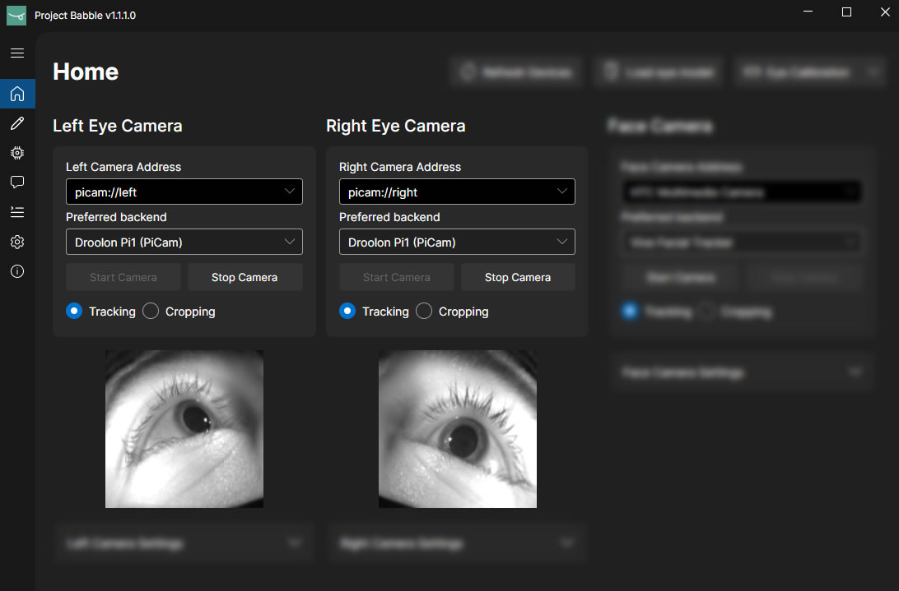

# Baballonia.PiCam

Baballonia capture module for the Droolon Pi1 eye tracker using [PiCamEmbedded](https://github.com/FynnleyNeko/PiCamEmbedded).



## Install

[Download](https://github.com/NGenesis/Baballonia.PiCam/releases) the latest release and extract the contents into your `<BaballoniaInstallPath>` (e.g. `C:\Program Files\Steam\steamapps\common\Baballonia` for Steam installations)

The folder structure should look like:
```
<BaballoniaInstallPath>\
	PiCamEmbedded.dll
	PiCamEmbedded\
		{config.ini, *.dll, ...}
	Modules\
		Baballonia.PiCam.dll
```
In Baballonia, configure the eye cameras with the following settings:

| Eye | Address | Preferred Backend |
|---|---|---|
| Left | `picam://left` | `Droolon Pi1 (PiCam)` |
| Right | `picam://right` | `Droolon Pi1 (PiCam)` |

## Optional settings

Optional settings can be applied using the camera address (e.g. `picam://left?highres=1&fps=60&exposure=110`).


> :warning: Settings are applied to both eyes using the first eye camera that is started so both eyes should use the same settings.

| Setting | Value | Default | Description |
|---|---|---|---|
| `fps` | `1`-`100` | `100` | Target refresh rate - 320x240 supports refresh rates up to 100Hz, 640x480 supports refresh rates up to 30Hz |
| `exposure` | `50`-`130` | `100` | Exposure level percentage |
| `highres` | `0`: 320x240, `1`: 640x480 | `0` | Target resolution |

## Known issues

- Stopping or disconnecting the eye tracker cameras may sometimes cause preview windows to appear in a hung state.  Starting and stopping the cameras usually resolves this until Baballonia is next restarted.

## Building from source
Build the project using `Baballonia.PiCam.csproj`.
Copy the files and folder output from `bin\` to your `<BaballoniaInstallPath>`. An archive of the files are output to `release\`.


> :warning: If your `<BaballoniaInstallPath>` is not a Steam installation path, configure `BaballoniaInstallPath` manually as needed in `Baballonia.PiCam.csproj`.

## References

- [PiCamEmbedded](https://github.com/FynnleyNeko/PiCamEmbedded)
- [Baballonia](https://github.com/Project-Babble/Baballonia)
